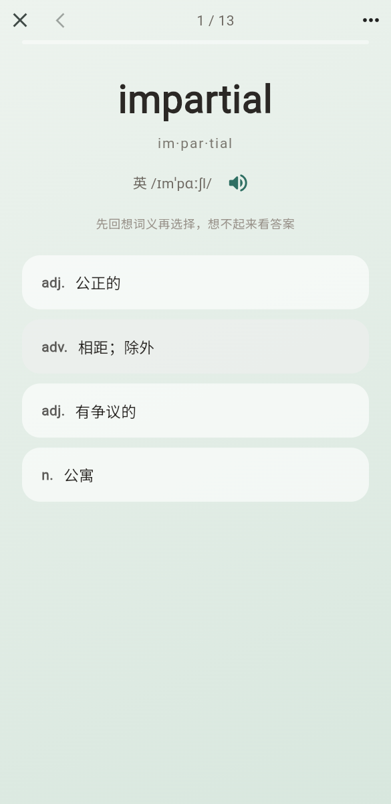
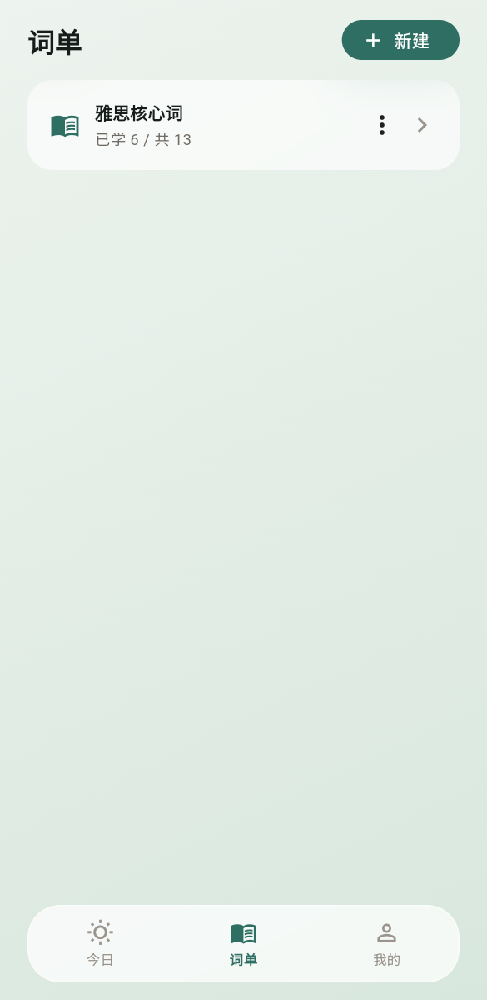
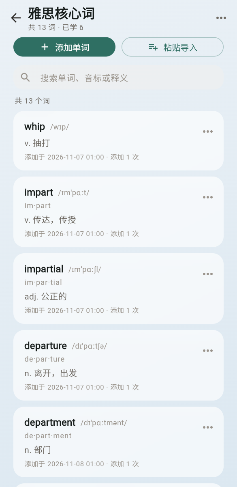
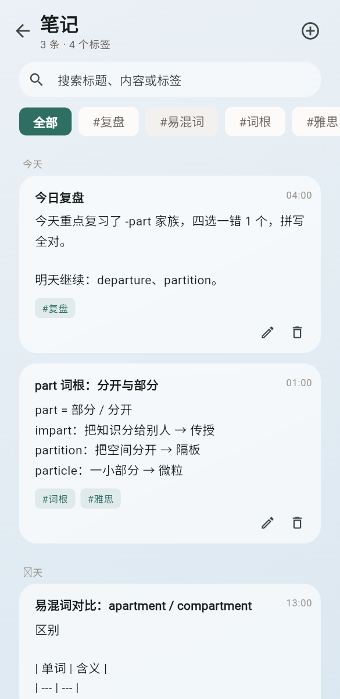
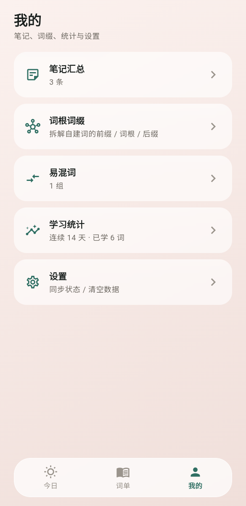

# 拾词 · WordPick

**把自己的单词本，变成每天都能坚持的学习闭环。**

自建词书 → 四选一学习 → FSRS-6 复习 → 拼写巩固 → 笔记沉淀 → 学习统计，一个跨端应用全部完成，数据默认只存在本地。

<p align="center">
  
</p>

<p align="center"><sub>真实界面录屏：签到与待复习 → 四选一即时反馈 → 词书管理 → 学习统计</sub></p>

<p align="center"><a href="docs/media/demo.gif">▶ 若动图未加载，点此直接打开完整演示（约 19 秒 / 1.3 MB）</a></p>

---

## 核心功能

| 模块 | 能做什么 |
|---|---|
| 自建词书 | 新建多本词书，逐条添加或用文本 / JSON 批量导入；离线词典自动补全音标与释义 |
| 四选一学习 | 看词选义，答完立即判分并展示完整释义；支持音节分节、英美发音与上一词回看 |
| FSRS-6 复习 | 按记忆稳定性安排到期日，默认 FSRS-6，可一键回滚 SM-2；到期词按组分批 |
| 拼写练习 | 听音看义拼单词，编辑距离容错，四级渐进提示（首字母 → 音节 → 词根 → 四选一） |
| 笔记 | Markdown 编辑与预览，支持标题、标签、时间线检索，可导出 Markdown |
| 词根词缀 | 自动拆解单词的前缀 / 词根 / 后缀，辅助理解性记忆 |
| 易混词 | 2–4 个词绑成一组，学习时同组连续出现，集中辨析 |
| 学习统计 | 签到、连续天数、今日已学、14 天柱状图与累计数据 |
| 发音 | 有道 dictvoice 英美发音，首次播放后本地缓存；失败时用设备 TTS 兜底 |
| 数据 | 本地优先；可选云端同步，支持完整 JSON 备份与合并恢复 |

## 亮点

- **不用注册，开箱即用**：无账号体系，首次打开即可建词书；Web 端打开网页就能学。
- **数据是自己的**：词书、进度、笔记均为标准 JSON，可导出、可合并恢复，也能通过自建 PostgREST 多端同步。
- **学习闭环完整**：不是单一背词页，而是「学 → 练 → 记 → 查 → 统计」一条链路，学完能看到连续天数与 14 天趋势。
- **调度算法可回滚**：默认 FSRS-6，同时保留 SM-2；切换为懒迁移，旧到期日不受影响，可无损回退。
- **移动端体验优先**：单列大卡片、大按钮、底部三 Tab，390px 宽度下完整可用，Web 与 Android 共用一套代码。

## 主要功能说明

### 1. 自建词书与批量导入

建一本自己的词书（如「雅思核心词」），逐条添加或整段粘贴。支持纯文本与结构化 JSON：

```json
[{ "word": "impartial", "defs": [{ "pos": "adj.", "cn": "公正的" }] }]
```

添加时离线词典会自动带出音标与释义，省去逐个查词、复制粘贴的步骤；JSON 导入让整理好的词表一次性入库。

### 2. 四选一学习卡

每个词展示拼写、音节分节、音标与发音，四个释义中选一个。选完立即用颜色标出正误并展开完整释义，答错也能当场纠正，不用等整组结束。

- 到期复习词与新词按设置的上限分组，避免一次堆积上百张卡。
- 易混词同组连续出现，趁热辨析。
- 可回看上一个词（只读），忘记上下文时不用退出重来。

### 3. FSRS-6 复习调度

每次评分后更新记忆稳定性与到期日，按「今天该复习什么」组织队列。相比固定间隔，复习量更贴合实际记忆情况；同时保留 SM-2 作为可回滚基线，设置里随时切换。

### 4. 拼写练习

给出释义与发音，要求拼出单词。输入按编辑距离容错，提示分四级逐层释放：首字母 → 音节数量与分节 → 词根 → 四选一。相比直接看答案，先回忆再逐级求助，更接近主动回忆。

### 5. 笔记、词根词缀与易混词

- 笔记独立于单词存在，可写复盘、语法点、词根总结，Markdown 实时预览，按标签与关键词检索。
- 词根词缀页自动拆解前缀 / 词根 / 后缀。
- 易混词组把容易混的词绑在一起，学习时集中出现。

### 6. 学习统计与签到

每日学习记录派生签到与连续天数；统计页展示今日已学、累计已学、最近 14 天柱状图，以及笔记、词书、自建词数量，用来判断节奏是否稳定。

## 界面截图

<table>
  <tr>
    <td align="center"><br><sub>今日：签到与待复习</sub></td>
    <td align="center"><br><sub>学习：四选一即时反馈</sub></td>
    <td align="center"><br><sub>词单：多本词书</sub></td>
  </tr>
  <tr>
    <td align="center"><br><sub>词本详情：词条与音标</sub></td>
    <td align="center"><br><sub>笔记：Markdown 与标签</sub></td>
    <td align="center"><br><sub>统计：连续天数与 14 天趋势</sub></td>
  </tr>
  <tr>
    <td align="center"><br><sub>我的：功能入口</sub></td>
  </tr>
</table>

## 技术栈

| 层 | 选型 |
|---|---|
| 框架 | Flutter 3.50 / Dart 3.13（`material_ui`） |
| 本地存储 | 原生：`sqlite3`；Web：`localStorage` |
| 音频 | `audioplayers` + 有道 dictvoice，失败时 `flutter_tts` 兜底 |
| 网络 | `http`；云同步直连腾讯云开发 PostgREST（可选） |
| 测试 | `flutter test`，`lib/domain` 纯逻辑与 `data` 仓储分层单测 |

## 快速开始

环境：Flutter 3.50，JDK 17，Android SDK（构建 APK 时需要）。

```bash
dart pub get                      # 依赖解析（不要用 flutter pub get）
scripts\preview_web.cmd           # 本地预览，浏览器打开 http://localhost:8091
flutter analyze --no-pub          # 静态检查
flutter test --no-pub             # 单元测试
flutter build web --release       # Web 产物 build/web
scripts\build_apk.cmd             # 打包 Release APK（混淆 + 符号剥离）
```

> Web 预览与 APK 构建脚本会把中间产物写到 `%TEMP%`，避免编辑器的文件监视器干扰 `build/` 下的增量缓存。

## 产品形态

| 形态 | 状态 | 说明 |
|---|---|---|
| Web | 可用 | 浏览器直接运行，含 PWA manifest；适合电脑与手机浏览器 |
| Android APK | 可用 | Release 包，安装名「拾词」，版本 0.23.0 (23) |
| iOS / macOS | 工程保留 | 未在真机验证 |
| Windows | 工程保留 | 本机缺 VS C++ 工作负载与开发者模式，暂无法构建 |

> 「拾词 · WordPick」为作品名，安装名与应用内顶部标识统一为「拾词」；包名 `english_study` 保持不变（影响已发布包的升级，不建议改动）。

## 更新日志

### v0.23.0
- 云同步改为 **BYOC 运行时自配**：在「设置 → 同步配置」填入你自己的 CloudBase 环境、Key 与用户标识即可启用；仓库与 APK 不再内置任何云端地址或密钥
- 每人用自己的环境实现数据隔离，不同人数据互不干扰；不再需要为换环境重新构建

### v0.22.0
- 应用名统一为「拾词」（Android / iOS / Web）
- 移除拍照识别（ML Kit OCR），安装包更小，权限只保留联网
- 自建词书导入：多格式兼容、多释义去重、失败原因提示
- 四选一在多释义时随机选择考点；复习默认 FSRS-6，可无损回退 SM-2
- README 截图与演示 GIF 按当前版本重新采集

## 隐私与安全

**默认不往云端存数据**
- 无账号、无埋点、无第三方统计 SDK；词书、进度、笔记默认只写本机（原生 SQLite / Web localStorage）。
- 云同步默认关闭，仓库与安装包都不内置云端地址或密钥。需要时在 App「设置 → 同步配置」里填入**你自己的** CloudBase 环境 ID、Publishable Key 与用户标识即可启用（BYOC）。
- 数据隔离靠「每人用自己的环境」：不同环境互不可见。同一人多台设备用同一个用户标识互通；不要把带 Key 的安装包发给他人。建表脚本见 [docs/cloudbase_schema.sql](docs/cloudbase_schema.sql)。

**仍然会出网的两处**
- 发音：向有道 `dictvoice` 请求音频，会把**被查询的单词**发给有道；失败时回退设备本地 TTS。
- 开启云同步后：学习数据 JSON 上传到你自己配置的云端。

**密钥与签名**
- 客户端只放 Publishable（anon）Key；`service_role` 等私钥必须留在服务端。
- 正式包由 `android/key.properties` 指定的 keystore 签名（该文件与 keystore 均不入库）。更换签名后，手机上已安装的旧版本需要卸载重装。

**边界说明**
- APK 一定能被反编译，内置词库与客户端逻辑无法真正隐藏。发布版开启 R8 + Dart 混淆 + 符号剥离，只是提高阅读成本，不当作安全边界。
- 本机数据未加密：能解锁设备或导出应用数据的人可以读到学习记录；更高要求可用系统应用锁，或自行接入 SQLCipher。

## 目录结构

```
English/
├── lib/
│   ├── main.dart                 入口与三 Tab 导航
│   ├── app_state.dart            全局状态 + 业务编排
│   ├── data/                     仓储、持久化、云同步
│   ├── domain/                   纯逻辑（SRS、四选一、拼写、导出解析…）
│   ├── services/                 发音、缓存、导出
│   └── ui/                       页面（今日 / 学习 / 词单 / 拼写 / 笔记 / 统计 / 我的 …）
├── assets/data/                  离线词典 dict_core.json、词缀 affixes.json
├── android/  ios/  macos/  windows/  web/
├── docs/                         设计、接口、决策与已知问题
│   ├── media/                    README 截图与演示 GIF
│   └── research/                 早期调研与避坑记录
├── scripts/                      预览、打包与词典生成脚本
├── test/                         领域与数据层单测
├── PROJECT_MEMORY.md             开发历程与经验沉淀
└── HANDOVER.md                   交接说明
```

## 文档

| 文件 | 内容 |
|---|---|
| [docs/requirements-v1.md](docs/requirements-v1.md) | 需求与界面方案 v1 |
| [docs/architecture.md](docs/architecture.md) | 技术栈、代码结构与数据流 |
| [docs/api.md](docs/api.md) | dictvoice、PostgREST 与本地存储约定 |
| [docs/conventions.md](docs/conventions.md) | 编码 / 构建 / 测试 / Git 约定 |
| [docs/decisions.md](docs/decisions.md) | 技术决策记录 D01–D45 |
| [docs/feature-map.md](docs/feature-map.md) | 功能地图、已完成清单与后续想法 |
| [docs/known-issues.md](docs/known-issues.md) | 已知问题与规避方案 |
| [docs/research/](docs/research/) | 早期调研、API 实测与设计参考 |
| [HANDOVER.md](HANDOVER.md) | 交接文档 |
| [PROJECT_MEMORY.md](PROJECT_MEMORY.md) | 逐次开发会话的经验沉淀 |
